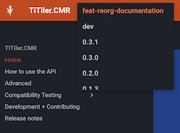

# Development - Contributing

Issues and pull requests are more than welcome: <https://github.com/developmentseed/titiler-cmr/issues>

**dev install**

This project uses [`uv`](https://docs.astral.sh/uv/) to manage the python environment and dependencies.
To install the package for development you can follow these steps:

```bash
# install uv

# unix
curl -LsSf https://astral.sh/uv/install.sh | sh

# or windows
# powershell -c "irm https://astral.sh/uv/install.ps1 | iex"

git clone https://github.com/developmentseed/titiler-cmr.git
cd titiler-cmr
uv sync --all-extras
```

## Linting

This repo is set to use `prek` to run *validate-pyproject*, *ruff* (lint and
format), and *mypy* when committing new code.

```bash
uv run prek install
```

If commits fail with `No module named pre_commit`, a hook installed by
`pre-commit` is still in place. Replace it with `uv run prek install --force`.

## Testing

You can then run the tests with the following command:

```bash
uv run pytest
```

The tests use `vcrpy <https://vcrpy.readthedocs.io/en/latest/>`_ to mock API calls
with "pre-recorded" API responses. When adding new tests that incur actual network traffic,
use the ``@pytest.mark.vcr`` decorator function to indicate ``vcrpy`` should be used.
Record the new responses and commit them to the repository.

```bash
uv run pytest -v -s --record-mode new_episodes
```

## Documentation

The documentation is generated using `mkdocs` and gets built and deployed to Github Pages when new tags are released and on pushes to the `develop` branch.

To preview the documentation in your browser you can run:

```bash
uv run mkdocs serve -o
```

### Previewing documentation changes

To preview documentation changes on a specific branch, you can deploy a specific branch to the documentation site using Github Actions workflow dispatch. This will create a new "version" of the documentation which is discoverable in the documentation drop down:



This "version" of the documentation is really just a new directory of the documentation in the gh-pages branch of this repository. 

Remember to delete that branch when you are done:


```
uv run mike delete feat-reorg-documentation --push
```

This will:
1. Delete the feat-reorg-documentation version from the documentation
2. Push the changes to the gh-pages branch

## Issues

Open an issue with the form that fits it, and the form sets the issue's type:

- **Bug**: titiler-cmr gives a user a wrong result, an error it should not, or
  a timeout on a request within its own limits.
- **Feature**: a new capability a user can call.
- **Task**: everything else, including build, deploy, CI, dependencies, tests,
  docs, refactoring, and performance work that does not fix a wrong result.

To work on an issue, comment on it, and a maintainer will assign it to you.

### How issues are tracked

- **Labels** mark the part of the project an issue touches, e.g.,
  `timeseries`, `tiles`, or `ci`.
- **Status** is where the issue stands: Backlog, Todo, In progress, In review,
  or Done. GitHub moves an issue to In review when a pull request that closes
  it is ready for review. A maintainer moves any issue it misses (e.g., one
  closed by a pull request from a fork), and the Triage list shows them.
- **Priority** orders the work within a milestone: Urgent, High, Medium, or
  Low. Maintainers set it, and GitHub does not show it to logged-out readers.
- **Milestone** is the release an issue is planned for (see the Milestones
  section).

Open issues by status: [Backlog][backlog], [Todo][todo],
[In progress][in-progress], and [In review][in-review].

[Triage][triage] lists the open issues that need a maintainer's attention:
issues whose type is not Bug, Feature, or Task, and issues with a linked pull
request whose status is not In review. Maintainers keep it empty. A pull
request that closes without merging stays linked, so a maintainer deletes the
closing keyword (e.g., `Closes #12`) from its description and sets the issue's
status to match the work left.

[backlog]: https://github.com/developmentseed/titiler-cmr/issues?q=is%3Aissue+is%3Aopen+status%3ABacklog
[todo]: https://github.com/developmentseed/titiler-cmr/issues?q=is%3Aissue+is%3Aopen+status%3ATodo
[in-progress]: https://github.com/developmentseed/titiler-cmr/issues?q=is%3Aissue+is%3Aopen+status%3A%22In+progress%22
[in-review]: https://github.com/developmentseed/titiler-cmr/issues?q=is%3Aissue+is%3Aopen+status%3A%22In+review%22
[triage]: https://github.com/developmentseed/titiler-cmr/issues?q=is%3Aissue+is%3Aopen+%28%28linked%3Apr+-status%3A%22In+review%22%29+OR+%28-type%3ABug+-type%3AFeature+-type%3ATask%29%29

## Milestones

Each open [milestone][milestones] is a planned release. The lowest one is the
next release, and its version matches the open release pull request from
release-please.

When the pull request that closes an issue opens, a maintainer confirms or
moves its milestone, so the milestone matches the release that will ship the
change. A feature goes to the next minor milestone (e.g., `v1.2.0`), because
release-please bumps the minor version for a `feat:` commit. Any other change
goes to the lowest open milestone (e.g., `v1.1.7`), because it ships in the
next release.

A feature that merges while a patch milestone is still open makes the next
release a minor one, so the maintainers shift every open milestone and move
the feature's issue to the lowest one. The patch milestones become the new
minor release and the patches after it, and each minor milestone moves up one.
For example, if a feature merges while `v1.1.7` is the lowest, `v1.1.7`
becomes `v1.2.0`, `v1.1.8` becomes `v1.2.1`, and `v1.2.0` becomes `v1.3.0`.
They rename from the highest milestone down, so no two milestones carry the
same title at once, and each milestone keeps its issues. A breaking change
makes the next release a major one, and the milestones shift the same way
(e.g., `v1.1.7` becomes `v2.0.0`, and `v1.2.0` becomes `v2.1.0`).

[milestones]: https://github.com/developmentseed/titiler-cmr/milestones

### Emergency patch

To release one fix ahead of the plan, merge it and follow the release
checklist (the "Release + deploy" issue template). If `main` contains changes
that are not ready to release, the fix needs a release branch, which this
repository will set up the first time that happens.

## Releasing

This project uses [`uv-dynamic-versioning`](https://github.com/nikvdp/uv-dynamic-versioning) to
derive the package version from git tags. The version seen by `importlib.metadata` (and therefore
the API's `/api` endpoint) is baked in at install time.

**Always create annotated tags** for releases — lightweight tags are not picked up by the
versioning tool:

```bash
git tag -a v1.2.3 HEAD -m "v1.2.3"
```

After tagging, re-sync your local environment so the new version is reflected immediately:

```bash
uv sync
```

When building Docker images locally, pass the version as a build argument:

```bash
APP_VERSION=1.2.3 docker compose up --build
```
